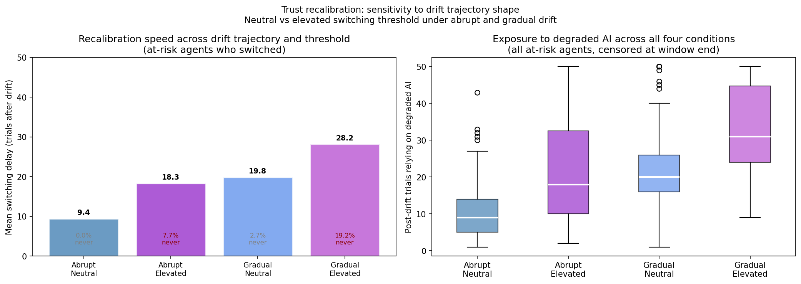

# Trust Recalibration Under Silent AI Degradation: An Agent-Based Simulation

*Julia Donovan · built in Python (NumPy) for an LSE MSc Behavioural Science module on agent-based modelling.*

**[▶ Try the interactive simulator](https://jul-de.github.io/human-ai-reliance-abm/)**: change the AI's reliability, how it degrades, users' learning rates and thresholds, and how much feedback they see, and watch reliance evolve.

A computational model exploring how individuals update trust and change reliance when an AI system's reliability deteriorates without explicit notification. The model introduces heterogeneous learning rates and behavioural switching thresholds, then examines how different degradation trajectories affect recalibration. It explores a theoretical distinction between learning from observed AI outcomes and deciding when to change reliance.



## The question

Human oversight is the main safeguard when AI systems are deployed in high-stakes settings, but it only works if people actually notice when an AI starts failing and change how much they rely on it. This model asks: **when an AI assistant silently becomes less reliable, do users recalibrate their reliance, how fast, and what makes recalibration fail?** It focuses in particular on the hypothesis that *anthropomorphic framing* (presenting the AI as warm or human-like) delays recalibration.

## The architecture

Each agent updates its trust in the AI after every outcome with a delta rule, T<sub>t+1</sub> = T<sub>t</sub> + α(O<sub>t</sub> − T<sub>t</sub>), and stops relying on the AI once its trust has fallen more than θ below its starting level. The model keeps two things separate that usually get collapsed together:

- **Learning rate (α):** how quickly trust updates in response to AI outcomes.
- **Switching threshold (θ):** how much accumulated trust loss is needed before the agent changes its reliance.

The separation is **inspired by Signal Detection Theory**'s split between sensitivity and decision criterion. It is an analogy, not a formal implementation: α and θ are a learning rate and a behavioural threshold, not estimates of d′ or c.

The key theoretical move: **the social-framing hypothesis is modelled as a higher switching threshold, not a lower learning rate.** Agents in the elevated-threshold condition register errors just as quickly, but need more accumulated trust loss before they change behaviour. This is anchored in [Peters & Scharlau (2025)](https://doi.org/10.3389/fpsyg.2025.1574809), who found that detection and action dissociate: people can register that an AI has degraded without changing how they use it. The model does not simulate an anthropomorphic interface directly. The elevated threshold stands in for a proposed mechanism through which social framing could affect reliance.

## Outcome measures

The switching rule is active from the first trial, so a run of errors can make an agent switch while the AI is still reliable. These pre-drift switches are reported as **false alarms**. For agents still relying on the AI when it degrades, the model reports three outcomes together:

1. the proportion who switch within the simulation window
2. the mean switching delay among those who switch
3. the mean exposure to the degraded AI (post-drift trials of continued reliance) across all of them

Within each trial an agent relies on the AI, sees the outcome, updates trust and only then decides whether to switch. The switch trial therefore counts as exposure, so for switchers exposure = switching delay + 1. Exposure is censored at the end of the window, so for agents who never switch it is a lower bound.

## What the model shows (four versions)

- **v1, baseline:** a delta-rule update with a fixed threshold reproduces the expected rise-then-fall pattern. 7 of 50 agents false-alarm before the drift; all 43 remaining agents switch, a mean of 8.7 trials after it. This confirms the mechanism, and that the threshold trades off false alarms against slow detection of real degradation.
- **v2, the core prediction:** with α held identical, raising θ from 0.25 to 0.40 increases the mean switching delay from 8.7 to 19.3 trials and mean exposure from 9.7 to 21.5 trials (about 2.2×). It also removes false alarms (4/25 → 0/25). The difference is driven entirely by the threshold.
- **v3, robustness and emergence:** drawing α and θ from distributions and pooling 10 runs shows the effect is robust (delay 10.2 vs 16.9 trials; exposure 11.4 vs 20.6). **The most interesting result is emergent and unprogrammed:** 8.4% of at-risk elevated-threshold agents *never switch* within the window, vs 0.5% of neutral agents. No rule makes agents stay with the AI. The randomness of the AI's outputs alone produces some never-switchers: in v2, with identical agents, one of 25 elevated-threshold agents already never switches. Variation between agents then roughly doubles the effect: in larger samples from the [simulator](https://jul-de.github.io/human-ai-reliance-abm/) (5,000 agents per condition), 5.3% of identical agents never switch, against 11.6% of varied ones. How large this group is depends on the whole distribution of thresholds and outcome sequences, which isn't obvious from the parameter values; simulating it is what an agent-based approach is for. The trade-off shows up at population level too: 12.8% of neutral agents false-alarm, vs 0.4% of elevated-threshold agents.
- **v4, drift trajectory:** replacing abrupt degradation with gradual drift (closer to how real AI degrades) *amplifies* the problem. The never-switch rate in the elevated-threshold condition rises from 7.7% to 19.2%, and mean exposure from 21.7 to 33.2 trials. Recalibration failure is worse, not better, when degradation is slow and silent.

## How to read the validation honestly

This is a **middle-range, conceptual model** doing **generative (pattern-oriented) validation**. It asks whether a principled mechanism reproduces known qualitative patterns from the trust and automation-bias literature (asymmetric updating, prior-anchoring, dose-response to error frequency). **It is not calibrated to a specific dataset, and it is not validated against individual human behavioural data.** Nor does it model the consequences of reliance: exposure counts trials of continued reliance, not harm. Its contribution is mechanistic. It shows that separating *updating* (learning rate) from *acting* (switching threshold) generates specific, differential predictions that can then be tested empirically, for example that interventions targeting threshold-crossing should outperform those targeting detection.

## Interactive simulator

[`docs/`](docs/) holds a browser version of the model ([live here](https://jul-de.github.io/human-ai-reliance-abm/)). It runs the v4 model (heterogeneous agents, abrupt or gradual drift) for the neutral and elevated-threshold conditions side by side, with presets for v2–v4. Every parameter can be changed, and it reports the same outcome measures as the notebook.

It adds one **extension that isn't in the notebook: feedback visibility**. Each outcome is seen with probability *v*. If it isn't seen, trust doesn't update, but the agent is still relying on the AI, so the trial still counts as exposure. At *v* = 1 the model is unchanged. With the v3 settings, hiding half the feedback raises the share of at-risk elevated-threshold agents who never switch from about 11% to about 35% (and from under 1% to about 7% for neutral agents), based on 5,000 agents per condition. One caveat: in this model, hiding feedback works much like a lower learning rate (fewer updates), so the model alone can't tell "sees less" apart from "learns more slowly".

The simulator is a JavaScript port with its own random number generator, so its runs don't match the notebook digit for digit. [`validation/compare.py`](validation/compare.py) checks it in three ways:

1. **Against the notebook:** a Python reference model (`validation/reference.py`) reproduces the notebook's v4 results exactly.
2. **Agent by agent:** both implementations are run through the same per-agent function on 5,000+ fixed outcome streams, and must give identical switch trials, exposure, reliability values and summary measures. This includes edge cases on the outcome definitions: switching at trial 0, trial 49 (the last pre-drift trial, so a false alarm), trial 50 (delay 0, exposure 1) and trial 99; never switching (exposure 50); trust loss exactly equal to θ, which does not trigger a switch; and an unseen error, which causes no update but still counts as exposure.
3. **Pooled:** the full simulations agree on false alarms, switch rate, switching delay and exposure (5,000 agents per condition, four configurations including the visibility extension).

The simulator page also has a **Results** section: fixed results for each preset with 5,000 users per condition (reproduce with `node validation/results.mjs`), what they show, and what they don't.

## Running it

```bash
pip install -r requirements.txt
jupyter notebook PB440_Model_v1.ipynb     # the model
python validation/compare.py             # simulator vs Python checks (needs Node 18+)
node validation/results.mjs              # results table on the simulator page
```

To run the simulator locally, serve `docs/` (e.g. `python -m http.server -d docs`) and open http://localhost:8000.

## Files

- `PB440_Model_v1.ipynb`: the model (code plus inline markdown explaining each version).
- `PB440_Model_v1.html`: rendered version with all outputs and plots visible (readable without running).
- `figures/`: the v2–v4 figures.
- `docs/`: the interactive simulator (`index.html`, with the model in `model.mjs`).
- `validation/`: the Python reference model, the simulator-vs-Python checks and the results-table script.

The version originally submitted for the module is tagged [`v1-submitted`](https://github.com/jul-de/human-ai-reliance-abm/tree/v1-submitted). The current version separates pre-drift false alarms from post-drift recalibration, reports switching delay and exposure for all at-risk agents, and reframes α/θ and the anthropomorphism condition more precisely.

## References

Cited in this README and in the notebook.

- Peters, T. M., & Scharlau, I. (2025). Interacting with fallible AI: Is distrust helpful when receiving AI misclassifications? *Frontiers in Psychology, 16*, 1574809. https://doi.org/10.3389/fpsyg.2025.1574809
- Waytz, A., Heafner, J., & Epley, N. (2014). The mind in the machine: Anthropomorphism increases trust in an autonomous vehicle. *Journal of Experimental Social Psychology, 52*, 113–117. https://doi.org/10.1016/j.jesp.2014.01.005

## Tools

Built in Python and NumPy (model) and JavaScript (interactive simulator), with Claude Code as a coding assistant.
